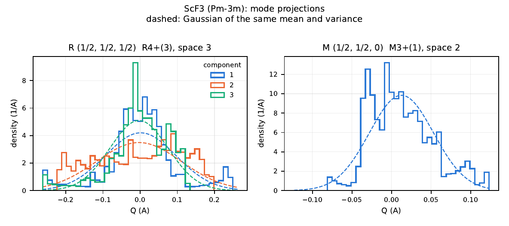

# crystod-md

MD-trajectory analyses. Three mode flags: `--adp` (atomic displacement
parameters as CIF), `--summary` (time-averaged lattice statistics) and
`--project` (projection onto the symmetry-adapted modes of the parent cell,
or with `--yaml` onto its phonon eigenvectors).

| I want to ... | command |
|---|---|
| get the ADPs of an MD run as a CIF file | `crystod-md --adp --dim 4 4 4 --start-step 1000` |
| get the time-averaged cell of an NpT run | `crystod-md --summary --start-step 1000` |
| follow the R4+ / M3+ amplitudes of an MD run and see whether they are single- or double-peaked | `crystod-md --project -c 221_PPOSCAR_ScF3 --dim 4 4 4 --start-step 1000 --qpoint R M` |
| check that the projected modes carry all of the displacement (sum rule) | `crystod-md --project -c 221_PPOSCAR_ScF3 --dim 4 4 4 --qpoint all --no-histogram` |
| compare the fluctuation of every phonon mode with the harmonic model (effective frequencies) | `crystod-md --project --yaml phonopy_params.yaml --dim 4 4 4 --start-step 1000 --qpoint R M GM --temperature 300` |
| project every arm of a star (the three M arms of a cubic parent) | `crystod-md --project -c 221_PPOSCAR_ScF3 --dim 4 4 4 --qpoint M --star` |

## 39. ADPs from an MD trajectory (`--adp`)

*Example directory: `example/39_xdatcar2adp` (testsuite section 39); after pip install: `crystod-example 39`*

```{note}
The `example/...` paths on this page are those of a clone of the repository,
used from its root. After `pip install CrystOD`, run `crystod-example NN` (the
number of the example directory) in your working directory first: it copies
that directory and the shared `test_POSCARs/` into `./example/`, and the
commands then run from there unchanged (see [crystod-example](crystod-example.md)).
```

Compute the time-averaged structure and anisotropic displacement parameters
(ADPs, U_ij) from a molecular-dynamics `XDATCAR` trajectory and write them as a
CIF file. The example is an NpT run of a 4x4x4 supercell of ScF3 at 300 K;
`XDATCAR_every10` holds every 10th frame of its equilibrated part
(configurations 2000 to 5000: 301 frames, 3.1 MB), so no frame is discarded
(`--start-step 0`):

```bash
cd example/39_xdatcar2adp/ScF3_Pm-3m_NpT_300K
crystod-md --adp --dim 4 4 4 --start-step 0 --xdatcar XDATCAR_every10 --output ADP.cif
```

```

* Input *
  Supercell size : [4, 4, 4]
  Start step     : 0
  Input file     : XDATCAR_every10
  Output file    : ADP.cif
  Reading XDATCAR... (this may take a while)

* Supercell info *
  atoms          : 256
  composition    : {'Sc': 64, 'F': 192}
  analyzed steps : 301
  Number of unit-cell sites (groups): 4
  Expected replicas per group       : 64

* Time-averaged unit cell *
  Space group: Pm-3m (No. 221)
  Atoms in unit cell   : 4
  Symmetry operations  : 48
  Asymmetric-unit sites: 2
    Sc0: mult=1, coords=(1.00000, 0.99999, 1.00000)
    F1: mult=3, coords=(0.00003, 0.50001, 0.00006)

* ADP constraints per Wyckoff position *
  Wyckoff 0 (Sc): site-symmetry order=48, U11=U22, U11=U33, U22=U33, U12=0, U13=0, U23=0
  Wyckoff 1 (F): site-symmetry order=16, U11=U33, U12=0, U13=0, U23=0

* Trajectory unwrapping *
  Coordinate unwrapping done: 256 atoms x 301 steps

* Atomic displacement parameters *
Site       Ueq (A^2)    Constraint
------------------------------------------------------------
Sc0        0.005477     U11=U22, U11=U33, U22=U33, U12=0, U13=0, U23=0
F1         0.023486     U11=U33, U12=0, U13=0, U23=0

* Output files *
  Saved: ADP.cif
```

The full 41.7 MB `XDATCAR` of the run (4001 frames; not in the pip package)
with `--start-step 1000` analyses all 3001 frames of the same
part and gives the same to 0.2 % (Ueq 0.005485 and 0.023521 A^2).

The written CIF ends with the symmetry-constrained `_atom_site_aniso_U_*`
loop, ready for thermal-ellipsoid display in VESTA — for NpT ScF3 at 300 K the
F ellipsoids are strongly anisotropic (U11 = U33 >> U22, the pancake shape
perpendicular to the Sc-F-Sc bond that drives the negative thermal expansion),
while Sc stays isotropic by symmetry:

```
loop_
 _atom_site_aniso_label
 _atom_site_aniso_U_11
 _atom_site_aniso_U_22
 _atom_site_aniso_U_33
 _atom_site_aniso_U_23
 _atom_site_aniso_U_13
 _atom_site_aniso_U_12
 Sc0     0.00548   0.00548   0.00548   0.00000   0.00000   0.00000
 F1      0.03260   0.00526   0.03260   0.00000   0.00000   0.00000
```

`--dim` is the MD supercell size relative to the unit cell, given as three
diagonal values or a nine-value diagonal matrix, quoted or unquoted
(`--dim 4 4 4`, `--dim="4 4 4"`, `--dim 4 0 0 0 4 0 0 0 4`; non-diagonal
matrices are rejected). `--start-step` discards the first N MD steps as
equilibration (default 0). `--xdatcar` defaults to `XDATCAR` and `--output` to
`ADP.cif`. `--format` selects the trajectory format (currently `vasp` only;
LAMMPS support is planned).

The workflow: the supercell trajectory is folded and grouped into unit-cell
sites (`--grouping-tolerance`, default 0.1, sets how far an atom may sit from
its site and still be grouped with it), the space group of the time-averaged
unit cell is detected with spglib (`--tolerance`, also default 0.1, a
Cartesian distance in Angstrom; the same distance selects the site-symmetry
operations of each site and maps every site onto its asymmetric-unit
representative), the per-atom displacement covariances are rotated into the
asymmetric-unit representatives and averaged over all symmetry-equivalent
atoms and MD steps, and site-symmetry constraints (e.g.
`U11=U22=U33, U12=U13=U23=0` on a cubic site) are enforced by projection.
Atoms that cannot be mapped onto their representative within `--tolerance`
are left out of the statistics and named, with their 1-based XDATCAR atom
numbers, in a `WARNING: N atom(s) could not be mapped ...` line of the
`* Trajectory unwrapping *` block.
The projection acts on the CIF components `U^ij` through
`M = N*^-1 R N*` with `N* = diag(|a*_1|, |a*_2|, |a*_3|)`, so an isotropic
tensor stays isotropic in every cell, the primitive cells of body-centred
tetragonal and orthorhombic lattices included (an atom on the 4/mmm site of
a bct primitive cell gets `U11=U22, U13=U23`, an isotropic tensor there
having nonzero `U23`, `U13` and `U12`); conventional cells and F-, C-centred,
rhombohedral and bcc primitive cells have `M = R`. The
constraint text lists only relations the projector imposes (`Uij=0`,
`Uij=Ukl`, `Uij=-Ukl`); a site constrained only by relations such as
`U12 = U22/2` (a two-fold axis along a of a hexagonal cell) reads
`general linear constraints only`, and one without constraints
`no constraint`. The printed `Ueq` is that of the tensor written to the CIF
(one third of the trace of its Cartesian form), so the table and the CIF
always agree. The CIF opens with the comment line
`# generated using crystod-md --adp` and contains the cell, the symmetry
operations, the asymmetric-unit sites, and the `_atom_site_aniso_U_*` loop,
ready for thermal-ellipsoid display in VESTA. Both fixed-cell and variable-cell (NpT,
repeated-header) XDATCAR files are supported.

In Python, `md.get_site_symmetry_operations(coords, rotations, translations,
symprec, lattice=L)` and `md.build_symmetry_projector(rotations, lattice=L)`
take the lattice (rows = lattice vectors, Angstrom) for the Angstrom
tolerance and the matrices `M`; without `lattice=` they keep the fractional
tolerance and use `R` itself, which is exact only for the cells with `M = R`
above.

Based on `script/xdatcar_to_adp.py` by Ko Sato, with a fast built-in parser in
place of the pymatgen reader. For the ScF3 example above the two write the
same CIF below the comment line (the script's reads
`# generated using xdatcar_to_adp.py`); the matrices `M`, the constraint text,
the tolerance in Angstrom, the WARNING and the `Ueq` of the written tensor
are CrystOD's (the script prints 0.005476 and 0.023485 in the `Ueq` column).

## 39.1 Trajectory summary (`--summary`)

*Example directory: `example/39_xdatcar2adp` (testsuite sections 39 and 41: `--summary` runs in the CLI-regression section); after pip install: `crystod-example 39`*

`crystod-md --summary` reports summary statistics of the same trajectory: the
time-averaged lattice parameters (a, b, c, alpha, beta, gamma) and cell volume
with standard deviations over the selected step range — useful for extracting
the equilibrium cell from an NpT run:

```bash
crystod-md --summary --start-step 0 --xdatcar XDATCAR_every10
crystod-md --summary --xdatcar XDATCAR_every10 --start-step 100 --end-step 200   # inclusive step range
```

```

* Input *
  Input file : XDATCAR_every10
  Reading XDATCAR... (this may take a while)

* Trajectory info *
  atoms          : 256
  composition    : {'Sc': 64, 'F': 192}
  total steps    : 301
  analyzed steps : 301 (step 0 .. 300)

* Time-averaged cell (mean +/- std) *
  a (A)       :      16.150052 +/- 0.077248
  b (A)       :      16.155792 +/- 0.067524
  c (A)       :      16.154326 +/- 0.068180
  alpha (deg) :      89.954570 +/- 0.214752
  beta (deg)  :      89.990552 +/- 0.261860
  gamma (deg) :      89.998191 +/- 0.218285
  V (A^3)     :    4214.959148 +/- 45.952311
  V/atom (A^3):      16.464684

NOTE: XDATCAR stores no energies or temperatures; Etot/T averages require OSZICAR/vasprun.xml.
```

`--start-step`, `--xdatcar`, and `--format` behave exactly as in `--adp` mode;
`--end-step` optionally truncates the range (default: last step). Note that
XDATCAR stores no energies or temperatures, so Etot/T averages are outside the
scope of `--summary`. Based on `script/md_summary.py`.

## 40. Mode projection of an MD trajectory (`--project`)

*Example directory: `example/40_md_projection` (testsuite section 40); after pip install: `crystod-example 40`*

`--project` answers how far an MD run moves along each symmetry-adapted
displacement pattern of the parent structure, and with what statistics: the
order-parameter time series Q(t) of every irrep, mode space and component at
the chosen q points. Its typical use is a crystal near a structural
instability, such as the octahedral tilts R4+ and M3+ of a perovskite: the
width of the distribution of Q tells how large the fluctuations are, and its
shape whether they are displacive (one well, a Gaussian about Q = 0) or
order-disorder (two populated states +Q0 and -Q0). Every frame is matched to
the ideal supercell of the parent primitive cell (`-c`, `--dim`), the
displacements are projected onto the bases that
`crystod-phonon --vibration` lists (same ISO-IR labels, mode-space and
component numbers for a parent in the standard setting), and the statistics
of every component are tabulated. The run is the ScF3 trajectory of section 39
(`crystod-example 40` copies `39_xdatcar2adp` and `33_modulation` along):

```bash
cd example/40_md_projection
crystod-md --project -c ../test_POSCARs/221_PPOSCAR_ScF3 --dim 4 4 4 \
    --xdatcar ../39_xdatcar2adp/ScF3_Pm-3m_NpT_300K/XDATCAR_every10 --start-step 0 \
    --qpoint R M -o MDPROJ_ScF3_300K
```

```

* Input *
  Parent cell     : ../test_POSCARs/221_PPOSCAR_ScF3
  Space group     : Pm-3m (No. 221)
  Supercell (dim) : 4 4 4 (64 parent cells, 256 atoms)
  Trajectory      : ../39_xdatcar2adp/ScF3_Pm-3m_NpT_300K/XDATCAR_every10 (301 frames)
  Frames used     : 301 (step 0 .. 300; configuration 2000 .. 5000)
  Lattice         : each frame's own cell (fractional -> Cartesian)

* Site matching *
  Sites matched   : 256 (one-to-one, by element and nearest image
                    of the time-averaged position)
  Uniform shift   : (+0.0000, +0.0000, +0.0000) A (mean offset of the averaged structure)
  Largest offset  : 0.0361 A (atom 222, uniform shift removed)
  Drift           : the mass-weighted centre-of-mass displacement is removed
                    from every frame (rms 0.0000 A)

* Q points *
  R        (1/2, 1/2, 1/2)
  M        (1/2, 1/2, 0)

* Mode projection at R (1/2, 1/2, 1/2) *
irrep   space  component  <Q> (A)   sqrt<Q^2> (A)  <|Q|> (A)  ratio  kurtosis  n_eff  shape
R1+(1)  1      1          -0.00004  0.00424        0.00344    0.811  -0.31     301    single-peaked
R3+(2)  2      1          -0.00007  0.00498        0.00395    0.792  0.50      301    single-peaked
R3+(2)  2      2          -0.00026  0.00664        0.00545    0.820  -0.43     301    single-peaked
R4+(3)  3      1          0.00146   0.09486        0.06716    0.708  1.34      16     single-peaked
R4+(3)  3      2          -0.00326  0.11411        0.09801    0.859  -1.08     19     single-peaked
R4+(3)  3      3          -0.00301  0.07826        0.05798    0.741  1.40      19     single-peaked
R4-(3)  4      1          -0.00005  0.00467        0.00368    0.789  -0.13     200    single-peaked
R4-(3)  4      2          -0.00014  0.00413        0.00330    0.800  -0.31     208    single-peaked
R4-(3)  4      3          -0.00018  0.00415        0.00335    0.809  0.30      205    single-peaked
R5+(3)  5      1          0.00001   0.01243        0.01043    0.839  -0.72     136    single-peaked
R5+(3)  5      2          0.00026   0.00677        0.00533    0.786  0.02      135    single-peaked
R5+(3)  5      3          0.00004   0.01060        0.00819    0.772  0.15      135    single-peaked

* Pooled components and norm |Q| at R (1/2, 1/2, 1/2) *
irrep   space  comps  sqrt<Q^2> (A)  ratio  kurtosis  n_eff  shape          <|Q|> (A)  |Q| ratio  Gaussian
R3+(2)  2      2      0.00587        0.800  0.02      602    single-peaked  0.00734    0.884      0.886
R4+(3)  3      3      0.09686        0.768  0.20      55     single-peaked  0.14807    0.883      0.921
R4-(3)  4      3      0.00432        0.798  -0.02     613    single-peaked  0.00687    0.918      0.921
R5+(3)  5      3      0.01021        0.781  0.09      406    single-peaked  0.01596    0.902      0.921

* Mode projection at M (1/2, 1/2, 0) *
irrep   space  component  <Q> (A)   sqrt<Q^2> (A)  <|Q|> (A)  ratio  kurtosis  n_eff  shape
M1+(1)  1      1          -0.00011  0.00387        0.00301    0.778  0.25      301    single-peaked
M3+(1)  2      1          0.01236   0.04246        0.03280    0.773  -0.08     29     single-peaked
M3-(1)  3      1          -0.00011  0.00464        0.00372    0.802  0.04      77     single-peaked
M3-(1)  4      1          -0.00030  0.00600        0.00474    0.791  0.19      175    single-peaked
M5+(2)  5      1          -0.00010  0.00747        0.00597    0.799  0.10      92     single-peaked
M5+(2)  5      2          0.00061   0.01563        0.01331    0.851  -0.88     91     single-peaked
M5-(2)  6      1          -0.00037  0.00421        0.00322    0.763  1.91      176    single-peaked
M5-(2)  6      2          0.00076   0.00395        0.00290    0.733  1.12      178    single-peaked
M5-(2)  7      1          -0.00120  0.01457        0.01126    0.773  0.22      88     single-peaked
M5-(2)  7      2          0.00106   0.01541        0.01250    0.811  -0.19     89     single-peaked
M2+(1)  8      1          -0.00008  0.00527        0.00399    0.757  0.40      301    single-peaked
M4+(1)  9      1          0.00005   0.01089        0.00883    0.811  -0.22     137    single-peaked

* Pooled components and norm |Q| at M (1/2, 1/2, 0) *
irrep   space  comps  sqrt<Q^2> (A)  ratio  kurtosis  n_eff  shape          <|Q|> (A)  |Q| ratio  Gaussian
M5+(2)  5      2      0.01225        0.787  0.04      183    single-peaked  0.01538    0.888      0.886
M5-(2)  6      2      0.00408        0.748  1.63      354    single-peaked  0.00487    0.844      0.886
M5-(2)  7      2      0.01499        0.792  0.02      177    single-peaked  0.01852    0.874      0.886

* Sum rule *
  sum of <Q^2> over the projected components : 0.031403 A^2
  <|u|^2> / N (all atoms, drift removed)     : 0.226273 A^2
  fraction covered                           : 13.88 %
  q points covered                           : 2 of 64 commensurate (a -q partner counts with its q)
...

* Output files *
  MDPROJ_ScF3_300K_R.csv
  MDPROJ_ScF3_300K_M.csv
  MDPROJ_ScF3_300K_hist.pdf
```



The figure is the histogram file of the same projection with `--irrep R4+ M3+`
on the full trajectory of section 39 (not in the pip package; `--start-step 1000`,
3001 frames): one panel per mode space, one step histogram per component,
dashed: the Gaussian of the same mean and variance. `XDATCAR_every10` gives
the same shapes with coarser bins.

**The amplitude Q.** Each row of a mode space is expanded on the supercell
(`SymmetryOnlyVibrations.get_supercell_displacements`, the Bloch factor of
every atom included) into a real pattern p, normalized over the whole
supercell, and

    Q(t) = p_hat . u(t) / sqrt(N),     p_hat = p / |p|,   N = n1 n2 n3,

with u(t) the Cartesian displacements of all atoms (after the drift removal
below). Q is the displacement norm per parent primitive cell carried by the
pattern. At a time-reversal invariant q (2q a reciprocal lattice vector:
GM, R, M, X of Pm-3m) it is the amplitude of
`crystod-phonon --modulation --amplitude` and `--vibration`. The R4+
structure that `--modulation --amplitude 0.3` writes on 2x2x2
(`example/33_modulation/ScF3_Pm-3m/POSCAR_I4mcm_3`), read as a one-frame
trajectory, gives

```
...
* Mode projection at R (1/2, 1/2, 1/2) *
irrep   space  component  <Q> (A)  sqrt<Q^2> (A)  <|Q|> (A)  ratio  kurtosis  n_eff  shape
R4+(3)  3      1          0.00000  0.00000        0.00000    -      -         -      zero
R4+(3)  3      2          0.00000  0.00000        0.00000    -      -         -      zero
R4+(3)  3      3          0.30000  0.30000        0.30000    1.000  -         -      n/a
...
```

The AMPLIMODES amplitude of `crystod-group --supergroup-cif` is normalized
in the primitive cell of the distorted structure instead: for an irrep it is
sqrt(size) times the norm of its Q over all components and all arms of the
star, with size the size of that cell in parent cells, so Q sqrt(size) when a
single component is nonzero. The same structure gives
`R4+ ... 140 I4/mcm 1 0.4243`, 0.3 sqrt(2); a structure with several
components or arms of one irrep, such as the M3+ of Im-3 frozen on three
arms with 0.3 each (size 4), gives sqrt(4 x 3 x 0.3^2) = 1.0392. At a q that
is not time-reversal invariant the rows are complex Bloch waves; each row e
gives the two real patterns of e and of i e (components `1c`, `1s`), and
since q and -q span the same real patterns, only one of the pair is
projected (`--qpoint all` keeps the first of each pair; a -q given
explicitly is reported as skipped). A modulation frozen there with
`--modulation --amplitude A` gives A/sqrt(2) as the norm of Q over its `c`
and `s` components (the rms per-cell displacement norm of the frozen wave);
for instance a phonon mode at (1/4, 1/4, 1/4) frozen with
`--amplitude 0.3` on 4x4x4 ScF3 gives sum Q^2 = 0.045 = 0.3^2/2.

**The synthetic check.** `make_xdatcar.py` in the example directory freezes
R4+ component 1 as 0.3 sin(2 pi t/50) A and the M3+ pattern at
M (1/2, 1/2, 0) as 0.17 cos(2 pi t/37) A on 2x2x2 ScF3 (100 frames, atoms
shuffled). Both come back to 1e-6 and every other component of R, M, X and
GM stays below 1e-9 (testsuite section 40):

```
...
* Mode projection at R (1/2, 1/2, 1/2) *
irrep   space  component  <Q> (A)  sqrt<Q^2> (A)  <|Q|> (A)  ratio  kurtosis  n_eff  shape
R4+(3)  3      1          0.00000  0.21213        0.19073    0.899  -1.50     6      double-peaked (hint)
R4+(3)  3      2          0.00000  0.00000        0.00000    -      -         -      zero
R4+(3)  3      3          0.00000  0.00000        0.00000    -      -         -      zero

* Pooled components and norm |Q| at R (1/2, 1/2, 1/2) *
irrep   space  comps  sqrt<Q^2> (A)  ratio  kurtosis  n_eff  shape    <|Q|> (A)  |Q| ratio  Gaussian
R4+(3)  3      3      0.12247        -      -         -      unequal  0.19073    0.899      0.921

* Mode projection at M (1/2, 1/2, 0) *
irrep   space  component  <Q> (A)   sqrt<Q^2> (A)  <|Q|> (A)  ratio  kurtosis  n_eff  shape
M3+(1)  2      1          -0.00845  0.12173        0.11029    0.906  -1.51     9      double-peaked (hint)

* Sum rule *
  sum of <Q^2> over the projected components : 0.059818 A^2
  <|u|^2> / N (all atoms, drift removed)     : 0.059818 A^2
  fraction covered                           : 100.00 %
  q points covered                           : 2 of 8 commensurate (a -q partner counts with its q)
...
```

**How to read the table.**

- `<Q>`, `sqrt<Q^2>`, `<|Q|>`: the mean, the root mean square and the
  mean absolute value of Q(t), in Angstrom. In a structure with the parent
  symmetry on average, `<Q>` of every non-identity irrep is zero to within
  the sampling; a nonzero `<Q>` is a static distortion (or a sampling
  artefact of a slow mode).
- `ratio` = `<|Q|>/sqrt<Q^2>`: sqrt(2/pi) = 0.798 for a Gaussian about
  Q = 0 (a displacive fluctuation in one well), 1 for two equally populated
  states +Q0 and -Q0 (order-disorder), 0.900 for a sinusoid.
- `kurtosis`: the excess kurtosis about the mean, 0 for a Gaussian, -2 for
  two sharp states, -1.5 for a sinusoid, positive for heavy tails.
- `n_eff`: the number of frames divided by the integrated autocorrelation
  time of Q(t) (summed to the first zero of the autocorrelation function),
  the number of effectively independent samples. The ratio and the kurtosis
  scatter by roughly 1/sqrt(n_eff); with n_eff below about 50 a single
  component says little about the shape. For a weakly damped oscillation
  the autocorrelation function crosses zero within a quarter period while
  the amplitude and phase stay correlated much longer, so n_eff is then an
  upper bound.
- `shape`: the histogram density at Q = 0 against its maximum (odd number of
  bins, symmetric about 0): below 0.5 with at least 10 % of the samples on
  each side, `double-peaked (hint)`; below 0.5 with the weight on one side,
  `off-center`; else `single-peaked`; `zero` for a component that does
  not move and `n/a` for fewer than 20 frames. It is a hint, not a test: a
  coherent oscillation of large amplitude (a sinusoid, as in the synthetic
  check) also reads as double-peaked, because it spends most of its time near
  its turning points.
- `* Pooled components and norm |Q| *`: for a mode space with several
  components. In the parent symmetry the components of one mode space are
  equivalent and share one distribution, so pooling their samples (columns
  `sqrt<Q^2>` to `shape`) improves the statistics; `<|Q|>` is the mean
  norm of the component vector, and `|Q| ratio` = `<|Q|>/sqrt<|Q|^2>` is
  compared with its value for an isotropic Gaussian in that many components
  (0.886 for two, 0.921 for three). Pooling is meaningful only when the
  components are equivalent in the run: when their rms values differ by more
  than a factor 3 (or one is zero), as for a frozen or ordered distortion
  along one component or for a weakly damped mode sampled in few phases,
  the pooled ratio, kurtosis and n_eff are not printed and the shape reads
  `unequal`.

For ScF3 at 300 K every irrep is single-peaked about Q = 0, as expected for
the cubic phase. The tilts carry by far the largest amplitudes
(`sqrt<Q^2>` about 0.1 A per cell for R4+, 0.04-0.08 A for M3+ on its three
arms), but they are also the slowest modes: n_eff is 16-19 for each R4+
component and 22-29 for M3+, against about 80-300 for the single components
of the other irreps (the stiff modes reach 301, the number of frames: ten
configurations apart, their frames are nearly uncorrelated). The ratios
of the single R4+ components therefore scatter (0.71, 0.86, 0.74), while the
pooled R4+ ratio is 0.768 (n_eff 55) and M3+ gives 0.773, near the Gaussian
0.798; no component is double-peaked, so the fluctuations are displacive.
The differences between the three R4+ components are sampling, not symmetry
breaking: averaged over the 48 cubic images of the same frames, the widths of
the components of every mode space become equal. The full trajectory
(not in the pip package; `--start-step 1000`) gives the same shapes, sqrt<Q^2>
within 0.0002 A and ratios within 0.015.

**Sum rule.** The real patterns of all commensurate q form an orthonormal
basis of the supercell displacements, so

    sum over all q, irreps and components of <Q^2>  =  <|u|^2> / N,

the mean-square displacement per parent cell after drift removal. The
`* Sum rule *` block prints both sides for the q actually projected and the
fraction covered; with `--qpoint all` (and no `--irrep`) the two agree to
rounding:

```bash
crystod-md --project -c ../test_POSCARs/221_PPOSCAR_ScF3 --dim 4 4 4 \
    --xdatcar ../39_xdatcar2adp/ScF3_Pm-3m_NpT_300K/XDATCAR_every10 --start-step 0 \
    --qpoint all --no-histogram -o all/MDPROJ_ScF3_300K
```

```
...
* Sum rule *
  sum of <Q^2> over the projected components : 0.226273 A^2
  <|u|^2> / N (all atoms, drift removed)     : 0.226273 A^2
  fraction covered                           : 100.00 %
  q points covered                           : 64 of 64 commensurate (a -q partner counts with its q)
  relative difference (complete basis)       : 0.0e+00
...
```

R and the M arm (1/2, 1/2, 0) alone carry 13.9 % of it (the first run). The
same number follows from the ADPs of section 39:
3 (U_eq(Sc) + 3 U_eq(F)) = 3 (0.005477 + 3 x 0.023486) = 0.2278 A^2 per cell,
0.7 % more. The two differ in their reference and their cell: `--adp`
measures each atom about its own time-averaged position, which leaves out
the static offsets of the averaged structure from the ideal sites (0.0012
A^2 per cell here), and converts all frames with the cell of the first
analysed frame, 0.4-0.7 % longer along each axis than the mean cell of the
run; `--project`
measures from the ideal parent sites, uses the cell of each frame
(`--mean-lattice`: the mean cell) and removes the centre-of-mass drift of
every frame. With the first frame's cell, the projection gives
0.2293 - 0.0013 = 0.2281 A^2, within 0.1 % of the ADP value.

**Options and files.**

- `--qpoint`: labels (`R M X GM`, the names `crystod-phonon --vibration
  --list-qpoints` prints), coordinates (`--qpoint 1/2 1/2 0`, any number of
  points in one list) or `all` (every q commensurate with `--dim`). The
  default is every tabulated special point commensurate with `--dim`, one
  arm each (GM, R, M, X for Pm-3m with an even `--dim`); the other arms of
  M and X are reached with coordinates, `all` or `--star`. A q that is not
  commensurate with `--dim` is refused.
- `--star`: replace every requested q (labels, coordinates, or the default
  special points) by all arms of its star (`crystod --star-of-k`), each with
  its own block and file (`--qpoint M --star` gives the three M arms of
  Pm-3m, `MDPROJ_ScF3_M_0.5_0.5_0.csv` and so on); of an arm and its -q
  partner only the one listed first is projected, as with `all`.
- `--yaml`, `--temperature`: the phonon-eigenvector basis and the effective
  frequencies, see [below](#phonon-eigenvector-basis---yaml).
- `--irrep R4+ M3+`: keep only these irreps (the dimension suffix is
  optional); the sum rule then covers that subset.
- `--start-step` / `--end-step`: the inclusive range of frames, counted from
  0 as in `--adp` and `--summary`; the CSV files carry the
  `configuration=` numbers of the XDATCAR.
- `--mean-lattice`: convert the fractional displacements of every frame with
  the time-averaged cell instead of the frame's own cell (no difference for
  a fixed-cell run).
- `-o PREFIX` (default `MDPROJ_<formula>`): `PREFIX_<q>.csv` per q
  (`step`, then one column per component named
  `<label>_<space>_<component>`, e.g. `R4+(3)_3_1`; when several q share a
  name, the coordinates are added, `MDPROJ_ScF3_M_0.5_0_0.5.csv`),
  `PREFIX_hist.pdf` (twelve panels per page; `--no-histogram` skips it),
  and with `--npz` `PREFIX.npz` (`steps`, `qpoints`, `qpoint_names`,
  `Q_<q>` and `labels_<q>` per q).
- `--tolerance`: the symmetry tolerance of the parent cell (default 1e-5).

**Limits.** `--dim` must be diagonal and the MD cell must be `--dim` times
the parent cell in the same orientation (each lattice vector within 10 % of
the parent's; the patterns are Cartesian in the axes of the parent file).
The parent must be the primitive cell, with the origin and setting whose
ISO-IR labels you want (the frame rules of the labels apply: the octahedral
tilts of SrTiO3 are R4+ with Ti at the origin and R5- with Sr). An atom
farther than 0.25 of the shortest parent lattice vector from every ideal
site of its element, two atoms on one site, or a composition other than
`--dim` times the parent's stop the run with an `ERROR:` line. Only VASP
XDATCAR files are read (`--format vasp`; fixed-cell and NpT). Without
`--yaml` the basis is the symmetry-adapted displacement patterns, not
normal modes: without force constants, a mode space of a repeated irrep (the three GM4- spaces of ScF3)
is one fixed orthonormal choice, and no mass weighting enters the patterns.
The drift removal subtracts the mass-weighted centre-of-mass displacement of
every frame (the quantity MD codes conserve; its rms is printed), so polar
optical motion, in which atoms of unequal mass move against each other, is
kept: a GM4- polar mode frozen with `--modulation --amplitude 0.3` projects
to a norm of 0.300 over the GM4- components. The ISO-IR names, mode-space
and component numbers are those of `crystod-phonon --vibration` when the
parent file is in the standard setting; `--project` works in the frame of
the `-c` file (as the trajectory does), while `--vibration` converts the cell
to the standard setting, so for a parent in another setting (for example
rutile with its axes permuted) the two can name and number q points and mode
spaces differently.

**Python API.**

```python
from crystod import md

symbols, lattices, frames = md.read_xdatcar("XDATCAR")
result = md.project_trajectory(
    "221_PPOSCAR_ScF3", (4, 4, 4), symbols, lattices[1000:], frames[1000:],
    qpoints=["R", "M"], irreps=["R4+", "M3+"])
for projection in result.projections:
    print(projection.name, projection.columns, projection.values.shape)
print(result.projected_msd, result.total_msd)
print(md.format_projection(result))
```

`project_trajectory` returns a `TrajectoryProjection` (per q a
`QProjection` with the column names, `Q(t)` as an array of shape
`(n_frames, n_columns)` and the statistics; the site matching; the sum-rule
numbers) and raises `ValueError` for bad input; `qpoints="all"` projects
every commensurate q (`md.commensurate_qpoints`).

### Phonon-eigenvector basis (`--yaml`)

With force constants the trajectory can be projected onto the phonon modes
themselves instead of onto symmetry-adapted patterns: `--yaml
phonopy_params.yaml` makes the basis at every q the eigenvectors of the
dynamical matrix, symmetry-adapted and numbered as `crystod-phonon
--modulation` and `--vector` number them (1-based, sorted by the harmonic
frequency, the partners of a degenerate level as `--modulation` freezes
them; the force constants are used without the non-analytical term
correction). The result is one time series per phonon mode, the normal
coordinate, and with `--temperature` an effective frequency for every mode:

```bash
cd example/40_md_projection
crystod-md --project --yaml ../33_modulation/ScF3_Pm-3m/phonopy_params.yaml \
    --dim 4 4 4 --xdatcar ../39_xdatcar2adp/ScF3_Pm-3m_NpT_300K/XDATCAR_every10 \
    --start-step 0 --qpoint R M GM --temperature 300 -o MDPROJ_ScF3_300K_phonon
```

```
...
* Mode projection at R (1/2, 1/2, 1/2), phonon-eigenvector basis *
mode  irrep   nu_harm (THz)  <a> (A sqrt(amu))  sqrt<a^2> (A sqrt(amu))  sqrt<A^2> per cell  ratio  kurtosis  n_eff  shape          nu_eff (THz)
1     R4+(3)  1.4169         0.05105            3.30782                  0.41348             0.708  1.34      16     single-peaked  0.7599
2     R4+(3)  1.4169         -0.11377           3.97887                  0.49736             0.859  -1.08     19     single-peaked  0.6317
3     R4+(3)  1.4169         -0.10492           2.72874                  0.34109             0.741  1.40      19     single-peaked  0.9212
4     R5+(3)  7.1689         0.00025            0.43352                  0.05419             0.839  -0.72     136    single-peaked  5.7982
...
12    R1+(1)  18.7661        -0.00124           0.14787                  0.01848             0.811  -0.31     301    single-peaked  16.9990

* Pooled degenerate levels and norm |a| at R (1/2, 1/2, 1/2) *
modes  irrep   comps  nu_harm (THz)  sqrt<a^2> (A sqrt(amu))  ratio  kurtosis  n_eff  shape          <|a|> (A sqrt(amu))  |a| ratio  Gaussian  nu_eff (THz)
1-3    R4+(3)  3      1.4169         3.37733                  0.768  0.20      55     single-peaked  5.16313              0.883      0.921     0.7443
4-6    R5+(3)  3      7.1689         0.35611                  0.781  0.09      406    single-peaked  0.55660              0.902      0.921     7.0586
7-9    R4-(3)  3      11.3334        0.23176                  0.798  -0.02     613    single-peaked  0.36848              0.918      0.921     10.8458
10-11  R3+(2)  2      13.6922        0.20474                  0.800  0.02      602    single-peaked  0.25603              0.884      0.886     12.2771
...
* Sum rule *
  sum of <a^2> over the projected modes      : 40.078043 amu A^2
  <sum m |u|^2> (supercell, drift removed)   : 302.308248 amu A^2
  fraction covered                           : 13.26 %
  q points covered                           : 3 of 64 commensurate (a -q partner counts with its q)
...
```

**Normal coordinates.** At q, mode nu has the unit eigenvector e_nu (3n
complex components, mass-weighted, in phonopy's atom-position phase
convention) and the harmonic frequency nu_harm (THz; an imaginary frequency
is printed as a negative number, as phonopy does). Its real pattern on the
supercell is

    p_nu(j, R) = Re[ e_nu,j exp(2 pi i q.(R + x_j)) ]

(and that of i e_nu, components `c` and `s`, at a q that is not
time-reversal invariant), built by the same code as the symmetry-only
patterns. The trajectory is taken in mass-weighted coordinates,
w_j(R) = sqrt(m_j) u_j(R) with the masses of the yaml and the
mass-weighted centre of mass of every frame removed, and

    a_nu(t) = p_hat_nu . w(t)      (A sqrt(amu), over the supercell)
    A_nu(t) = a_nu(t) / sqrt(N)    (per parent cell)

with p_hat the pattern normalized over the supercell. The patterns of all
modes at all commensurate q form an orthonormal basis of the mass-weighted
displacements, so

    sum over all q and modes of <a_nu^2>  =  < sum_jR m_j |u_j(R)|^2 >,

which the `* Sum rule *` block prints in amu A^2; with `--qpoint all` the
two agree to rounding (302.308248 amu A^2 for this run, relative difference
1.9e-16). The columns of the CSV files are named `<mode>_<irrep>`
(`1_R4+`, `4c_DT5`), the npz arrays `a_<q>` with `frequencies_<q>`, and the
histogram file has one panel per degenerate level. The default prefix is
`MDPROJ_<formula>_phonon`.

**Relation to `--modulation`.** `--modulation --amplitude A0` freezes
u_j(R) = A0 Re[v_j exp(2 pi i q.R)] with v_j = e_j exp(2 pi i q.x_j)/sqrt(m_j)
renormalized over the primitive cell, so at a time-reversal invariant q the
mode carries A = A0 |sqrt(m) v| per cell, the mass-weighted norm of the
renormalized pattern. At a q that is not time-reversal invariant the norm of
A over the c and s columns of the mode is A0 |sqrt(m) v| / sqrt(2), as for Q
in the symmetry-only basis. For the R4+ tilt of ScF3 only F moves, |sqrt(m) v| = sqrt(m_F) =
4.358716 sqrt(amu), and the one-frame trajectory of an R4+ structure frozen
with `--amplitude 0.3` gives A = 1.307615 on that mode and zero on every
other mode of the cell (the symmetry-only projection of the same frame gives
Q = 0.30000). Where an irrep occurs once at q, as R4+ and M3+ here, the
eigenvector is the symmetry-adapted pattern itself and A = sqrt(m) Q for a
single-species pattern; where it occurs several times (GM4- three times,
M3- twice), the eigenvectors are the combinations the force constants select.

**Effective frequency.** For a harmonic mode in equilibrium classical MD,
equipartition gives for the normal coordinate of the supercell

    <a_nu^2> = k_B T / omega_nu^2,

so `--temperature T` (kelvin) prints

    nu_eff = (1 / 2 pi) sqrt( k_B T / <a_nu^2> )

next to nu_harm, with k_B = 0.8314462618 amu A^2 ps^-2 K^-1, omega in rad/ps
and nu in THz; the pooled block gives it for the mean <a^2> of each
degenerate level. nu_eff is the frequency of the harmonic oscillator that
would have the same mean-square normal coordinate at T, a quasi-harmonic,
temperature-renormalized frequency. It assumes a classical run (no zero-point
motion) in equilibrium, sampled long enough (`n_eff`: <a^2> has a relative
scatter of about sqrt(2/n_eff)), and it is only that mode's frequency when
the harmonic eigenvector is also a normal mode of the run: the coordinate
of a mode can mix in the run with another mode of the same irrep at the same q,
and then shows a frequency between the two. A soft or imaginary harmonic
mode with a finite nu_eff is the anharmonic stabilization of that mode at T;
nu_eff below nu_harm means the run fluctuates more along the mode than the
harmonic model predicts. Only commensurate q are reached, so the zone
boundary appears only through the commensurate set of `--dim`, and the
acoustic modes at GM carry nothing after the centre-of-mass removal.

For the ScF3 run at 300 K (pooled levels; single modes where the level is
non-degenerate):

| q | modes | irrep | nu_harm (THz) | nu_eff (THz) |
|---|---|---|---|---|
| R | 1-3 | R4+ | 1.417 | 0.744 |
| R | 4-6 | R5+ | 7.169 | 7.059 |
| R | 7-9 | R4- | 11.333 | 10.846 |
| R | 10-11 | R3+ | 13.692 | 12.277 |
| R | 12 | R1+ | 18.766 | 16.999 |
| M | 1 | M3+ | 1.670 | 1.698 |
| M | 2 | M3- | 3.974 | 9.271 |
| M | 3-4 | M5- | 4.832 | 4.709 |
| M | 5-6 | M5+ | 5.070 | 5.885 |
| M | 7 | M4+ | 7.376 | 6.619 |
| M | 8-9 | M5- | 12.166 | 13.184 |
| M | 10 | M2+ | 13.687 | 13.667 |
| M | 11 | M3- | 13.940 | 13.997 |
| M | 12 | M1+ | 17.948 | 18.630 |
| GM | 1-3 | GM4- (acoustic) | 0.000 | - |
| GM | 4-6 | GM5- | 4.212 | 4.106 |
| GM | 7-9 | GM4- | 6.245 | 6.331 |
| GM | 10-12 | GM4- | 13.923 | 12.909 |

The stiff F-dominated modes above 10 THz follow the harmonic model: every
single mode lies within 21 % of nu_harm, the pooled levels within 11 %, and
most of the lower levels (R5+, M5-, GM5-, GM4-) agree to a few per cent as
well. The acoustic modes at GM carry nothing (<a^2> of order 1e-30 amu A^2,
rounding). The
M3+ tilt is harmonic in this run (1.698 against 1.670 THz). The R4+ tilt is
not: its pooled nu_eff, 0.744 THz, is about half of nu_harm, so the run
fluctuates along the R tilts about 3.6 times more (in <a^2>) than the
harmonic model predicts. The run and the force constants do not share a
reference: the MD cell averages 4.038 A per parent cell against 4.0696 A in
the yaml (-0.77 %, far more than a thermal expansion, so the energy model of
the run is not that of the force constants), and the kinetic temperature of
the run (in its MD log, which is not part of the repository) fluctuates with
a standard deviation of 72 K after 10 ps, against about 15 K for a canonical
ensemble of 256 atoms. The comparison of the soft tilts in this run
therefore says nothing about anharmonic stabilization. The lower M3- mode (9.271 against 3.974 THz)
belongs to an irrep that occurs twice at M: a coordinate that mixes in the
stiff 13.9 THz partner in the run comes out stiffer, which the table alone
does not separate from a stiffening of the mode itself. Single components of
one level scatter more than their n_eff suggests (R5+: 5.80, 10.64 and 6.80
THz) when the run does not sample the components equally over the window;
the pooled values are steadier.

**Parent cell and `-c`.** The parent cell is the primitive cell of the yaml
(its atom order, positions and Cartesian frame; the trajectory must be
`--dim` times that cell in the same orientation). `-c` is not needed with
`--yaml`; if both are given, the `-c` cell must be that cell (lattice
vectors and positions within the larger of `--tolerance` and 1e-4 A, atoms
in any order), else the run stops with an `ERROR:` line. A yaml without
force constants (`phonopy_disp.yaml`) is refused the same way.
`--temperature` needs `--yaml`.

**`--star` with the eigenvector basis.** `--qpoint M --star` projects the
modes of all three M arms; on the synthetic trajectory of the example
directory (M3+ frozen on (1/2, 1/2, 0)) the M3+ mode of that arm carries
sqrt<A^2> = 0.53058 A sqrt(amu) per cell = sqrt(m_F) x 0.12173 A and the
other two arms nothing:

```
* Q points *
  M        (1/2, 1/2, 0)
  M        (1/2, 0, 1/2)
  M        (0, 1/2, 1/2)

* Mode projection at M (1/2, 1/2, 0), phonon-eigenvector basis *
mode  irrep   nu_harm (THz)  <a> (A sqrt(amu))  sqrt<a^2> (A sqrt(amu))  sqrt<A^2> per cell  ratio  kurtosis  n_eff  shape
1     M3+(1)  1.6697         -0.10418           1.50072                  0.53058             0.906  -1.51     9      double-peaked (hint)

* Mode projection at M (1/2, 0, 1/2), phonon-eigenvector basis *
mode  irrep   nu_harm (THz)  <a> (A sqrt(amu))  sqrt<a^2> (A sqrt(amu))  sqrt<A^2> per cell  ratio  kurtosis  n_eff  shape
1     M3+(1)  1.6697         0.00000            0.00000                  0.00000             -      -         -      zero
...
```

**Python API.**

```python
import phonopy
from crystod import md

symbols, lattices, frames = md.read_xdatcar("XDATCAR")
phonon = phonopy.load("phonopy_params.yaml", is_nac=False)
result = md.project_trajectory(None, (4, 4, 4), symbols, lattices[1000:],
                               frames[1000:], qpoints=["R", "M", "GM"],
                               phonon=phonon, temperature=300, star=False)
r = result.projections[0]
print(r.columns[:3], r.frequencies[:3], r.effective_frequencies[:3])
print(result.projected_msd, result.total_msd)   # amu A^2 over the supercell
```
