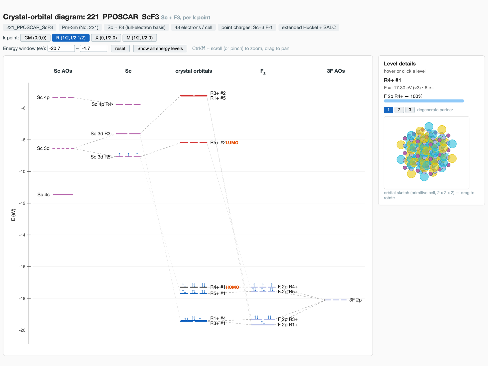
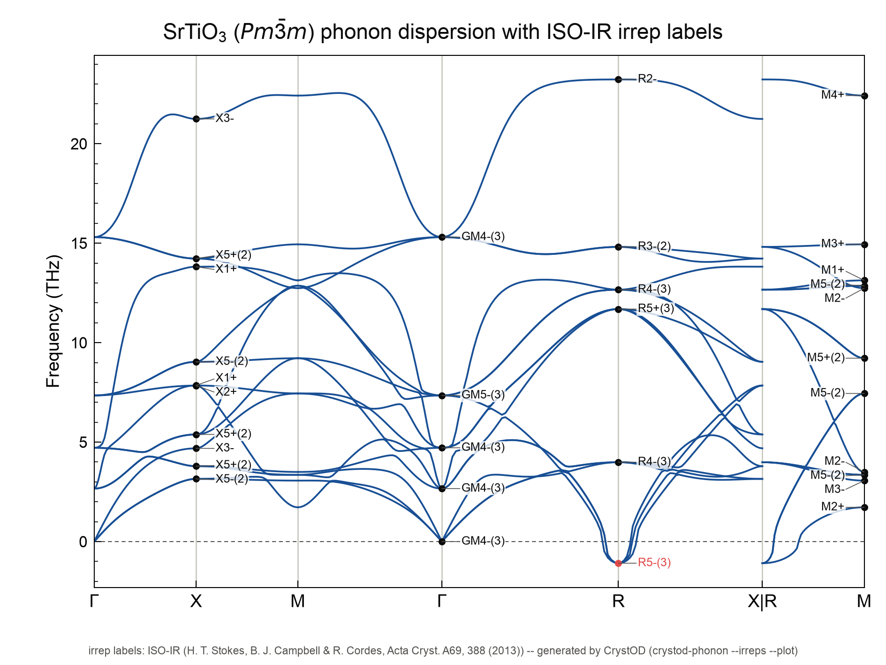
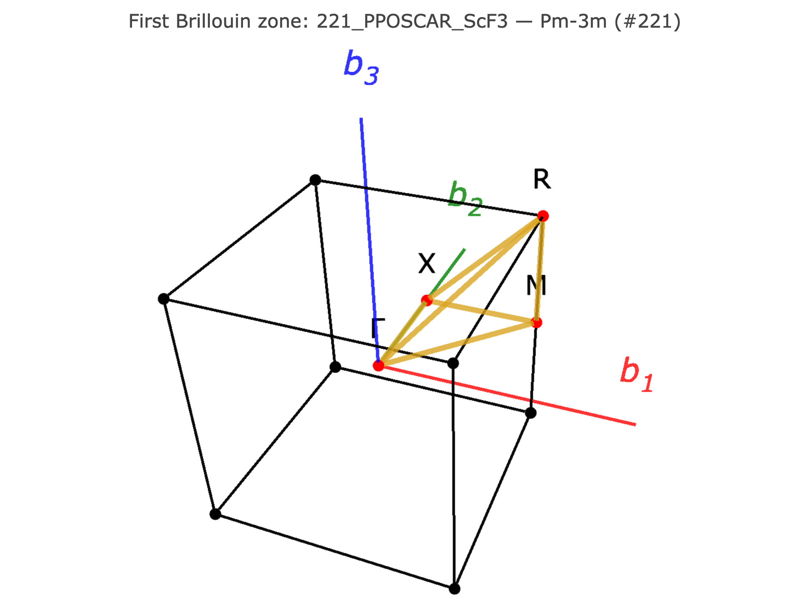
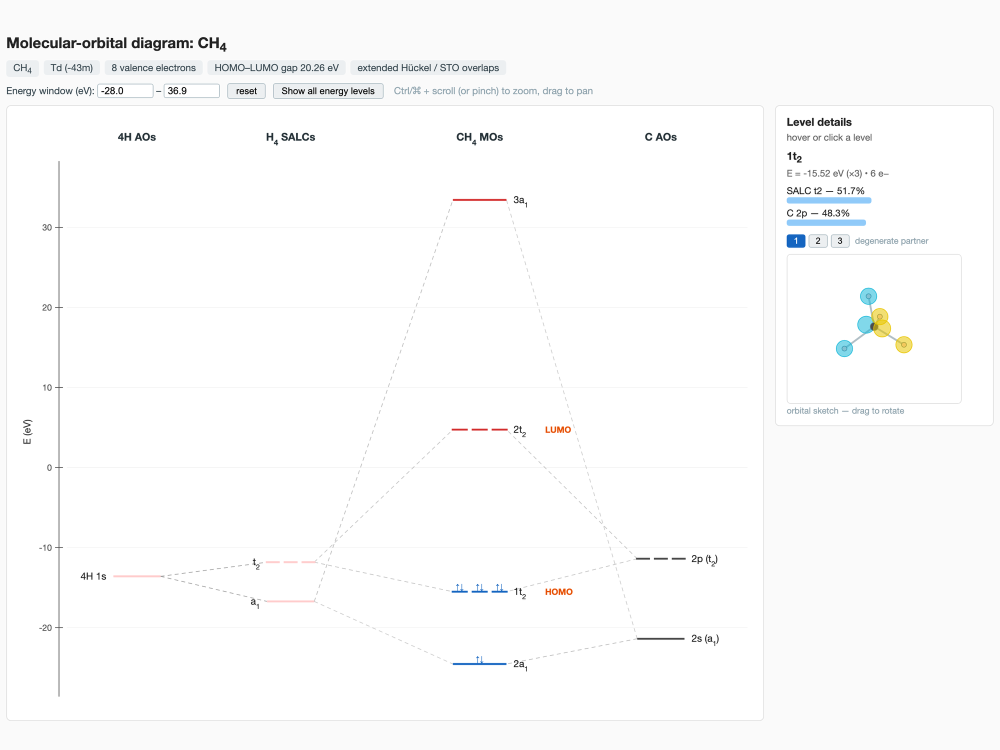

---
myst:
  html_meta:
    "description lang=en": "CrystOD (Crystal Orbital Diagram) is a command-line and Python toolkit for the symmetry analysis of crystals and molecules: LCAO crystal-orbital diagrams, SALC and space-group irreducible representations, isotropy subgroups, phonon irreps and symmetry-adapted modulations."
    "keywords": "CrystOD, crystal orbital diagram, SALC, symmetry-adapted linear combination, space group, irreducible representation, isotropy subgroup, phonon irreps, phonon modulation, crystallography software"
    "og:title": "CrystOD - Crystal Orbital Diagram"
    "og:description": "LCAO orbital diagrams for crystals, with full space-group symmetry labels: SALC and crystal-orbital irreps, isotropy subgroups, phonon irreps and symmetry-adapted modulations."
    "og:url": "https://mochizuki-tus.github.io/CrystOD/"
    "og:type": "website"
---

# CrystOD

**CrystOD** draws **crystal-orbital diagrams**: it takes a crystal
structure and shows how the atomic orbitals combine — with full space-group
symmetry labels — into the crystal orbitals at each k point, exactly the way a
molecular-orbital diagram explains a molecule. Around this core it provides a
complete symmetry toolbox: Symmetry-Adapted Linear Combinations (SALCs), 
basis functions, phonon irreducible representations, 
symmetry-adapted vibrations/modulations, magnetic (spin)
multipole bases, direct products, isotropy subgroups, and group 
representation theory.

```{list-table}
:widths: 50 50
:align: center

* - [](crystod.md#3-crystal-orbital-diagrams)
  - [](crystod-phonon.md#28-phonon-irreps---irreps)
* - [](crystod-bz.md#25-brillouin-zone-plot)
  - [](crystod-mol.md#43-molecular-orbital-diagrams---diagram)
```

Four outputs, each linked to its section. Top row: the crystal-orbital diagram
of ScF<sub>3</sub> (`crystod --diagram -c 221_PPOSCAR_ScF3 --co-left Sc --co-right F3`)
and the phonon irreps of SrTiO<sub>3</sub> drawn on the phonopy dispersion
(`crystod-phonon --irreps -c 221_PPOSCAR_SrTiO3 --dim "4 4 4"`); bottom row: the
Brillouin zone of ScF<sub>3</sub> (`crystod-bz -c 221_PPOSCAR_ScF3`) and the MO
diagram of CH<sub>4</sub> (`crystod-mol --diagram --xyz XYZ_CH4.xyz`). Every one
of these inputs is bundled with the package, so each runs right after
`pip install CrystOD` — see the "Try it" column below.

## New in v0.4.6

One line per feature: the command, what it gives, and the section that shows
its output.

- `crystod-phonon --unfold`: the phonon bands of a distorted phase unfolded
  onto the Brillouin zone of its high-symmetry parent, with the parent irrep
  of every unfolded level, every arm of the stars of the path vertices and the
  average over the orientation domains; the transformation and the origin
  shift come from the two POSCARs, as `crystod-group --supergroup-cif` finds
  them ([51](crystod-phonon.md#51-phonon-band-unfolding---unfold)); in Python,
  `crystod.phonon.unfold`
  ([Python API](python-api.md#band-unfolding-onto-the-parent-zone)).
- `crystod-phonon --visualize`: one standalone HTML page with every phonon
  mode at the special points of the k path, grouped by irrep (the labels of
  `phonon_irreps.yaml`, Mulliken symbol and activity at GM), as arrows and an
  animation in 3D next to the dispersion, and `band_vector.yaml`, phonopy's
  `band.yaml` with eigenvectors
  ([52](crystod-phonon.md#52-phonon-mode-viewer---visualize)); in Python,
  `crystod.phonon.phonon_viewer_data`
  ([Python API](python-api.md#phonon-mode-viewer)).
- `crystod-phonon --irreps` now also draws the phonon dispersion with the
  ISO-IR label of every level at the special points of the path, imaginary
  levels in red (`phonon_irreps.pdf`, next to the YAML file) — the figure at
  the top of this page
  ([28](crystod-phonon.md#the-dispersion-with-the-labels-phonon_irrepspdf)).
- `crystod-slab`: surface slabs cut from a POSCAR, every termination of the
  given Miller indices or of every index up to a maximum that is distinct
  under the crystal's Laue group, each tested for a dipole (polar) and for
  two equivalent faces (symmetric) and written as a POSCAR, with an
  interactive dialogue when no index is given
  ([53](crystod-slab.md#53-surface-slabs)); in Python, `crystod.slab`
  ([From Python](crystod-slab.md#from-python)).

In v0.4.6 the section numbers run from 1 to 53 (51 is
`crystod-phonon --unfold`, 52 is `crystod-phonon --visualize`, 53 is `crystod-slab`). The full list of changes and fixes, and the
features of v0.4.5 (the irreps of the electronic bands of a VASP run read from
its WAVECAR with `crystod --extract-irrep`, the example directories shipped
with the package and `crystod-example`, the pair labels and exact sums of
`crystod-group --parent`), is in the [changelog](changelog.md).

## CrystOD at a glance

Not sure what an "orbital diagram for a crystal" means? Play with the toy model
first, then look at the real outputs below — everything shown is generated by
CrystOD itself.

**1. The idea — from a molecule to a crystal** (interactive toy model):

<iframe src="_static/embed/molecule_to_crystal_simulator.html" width="100%" height="640" loading="lazy" style="border:1px solid #8884; border-radius:8px; background:#fff;"></iframe>
<p style="margin-top:0.3em"><a href="_static/embed/molecule_to_crystal_simulator.html" target="_blank">Open the simulator full-screen</a></p>

**2. A real molecule** — the NH<sub>3</sub> molecular-orbital diagram
(`crystod-mol --diagram --xyz XYZ_NH3.xyz`); the only thing you need is XYZ file! Hover the levels for the orbital sketches:

<iframe src="_static/embed/MolOD_XYZ_NH3.html" width="100%" height="660" loading="lazy" style="border:1px solid #8884; border-radius:8px; background:#fff;"></iframe>
<p style="margin-top:0.3em"><a href="_static/embed/MolOD_XYZ_NH3.html" target="_blank">Open the NH3 MO diagram full-screen</a></p>

**3. A real crystal** — the same construction for ScF<sub>3</sub>
(`crystod --diagram -c 221_PPOSCAR_ScF3 --co-left Sc --co-right F3`, or
`crystod --example ScF3_diagram`): Sc and F<sub>3</sub>
sublattice orbitals on the sides, the crystal orbitals with their
irreducible-representation labels in the middle, one page per special k point:

<iframe src="_static/embed/CrystalOD_221_PPOSCAR_ScF3.html" width="100%" height="660" loading="lazy" style="border:1px solid #8884; border-radius:8px; background:#fff;"></iframe>
<p style="margin-top:0.3em"><a href="_static/embed/CrystalOD_221_PPOSCAR_ScF3.html" target="_blank">Open the ScF3 crystal-orbital diagram full-screen</a></p>

## Commands

The package is organized phonopy-style: one main command plus one sectioned command
per research domain.

| Command | Domain |
|---|---|
| `crystod` | crystal-orbital SALC analysis (main command), `--diagram` (with dipole selection rules), `--band`/`--dos`, `--visualize`, `--star-of-k`, `--extract-irrep` (band irreps of a VASP run from its WAVECAR) |
| `crystod-group` | point/space-group representation-theory calculator (products, correlation tables, property tensors, isotropy subgroups, Landau invariants) |
| `crystod-bz` | Brillouin-zone plots (unit cell and supercell folding), special-k-point tables |
| `crystod-phonon` | phonon analyses (irreps, IR / Raman activity, fatband, LT bands, eigenvectors, modulation, vibration, subgroups of imaginary modes, band unfolding onto the parent zone, interactive 3D viewer of the modes by irrep) |
| `crystod-mag` | symmetry-adapted spin bases (cluster multipoles / SAMM); magnetic space groups, allowed responses and altermagnet classification |
| `crystod-md` | MD-trajectory analyses (ADPs, lattice summary, projection onto symmetry-adapted modes) |
| `crystod-mol` | molecular point groups, molecular SALCs, and MO diagrams (XYZ files) |
| `crystod-xrd` | powder X-ray and neutron diffraction patterns (Bragg peak list and broadened pattern); superlattice reflections of a distorted phase indexed on the parent, with k points and irreps |
| `crystod-search` | Materials Project search (formula, chemical system, elements, ID) and POSCAR download |
| `crystod-slab` | surface slabs: every termination of given or of all distinct Miller indices, polar and symmetric tests, POSCAR files |
| `crystod-example` | the packaged worked examples: lists the example directories and copies them into a working directory |

Every feature carries a shared section number used consistently across this
documentation, `testsuite.py`, and the `example/` directories of the repository:
feature *N* is tested by `python testsuite.py N` (in a clone of the repository)
and demonstrated in `example/<N>_*`, which ships with the package:
`crystod-example N` copies it into `./example` ({doc}`crystod-example`).

## What you can ask CrystOD

Every command prints its answer to the terminal; the ones that draw something
also write an HTML page, a PDF, or a VESTA file. A POSCAR (or an XYZ,
or nothing at all) is the only input, and `crystod-search` fetches the POSCAR of
any compound of the Materials Project. Every calculation runs offline, and
`crystod-search` is the only command that goes online. The 3D viewers of
`crystod --visualize`, `crystod-phonon --visualize`, `crystod-bz` and
`crystod-mol --visualize` load plotly.js from `cdn.plot.ly` when they are opened, so the browser needs a
network connection to display them; the crystal-orbital and MO diagram pages
are self-contained. The "Try it" column holds the bundled
example closest to each question: `--example NAME` copies the input files into
the working directory, prints the equivalent ordinary command line and runs it
(`--example` alone lists the names); `crystod-example NN` copies a whole example
directory, whose README holds the commands to run
([50](crystod-example.md#50-packaged-example-directories)).

| Question | Command | Try it | Section |
|---|---|---|---|
| Which irreps does this shell span at each k point? | `crystod -c POSCAR --element Ti --orbital d` | `crystod --example SrTiO3_d` | [2](crystod.md#2-irreps-of-salc) |
| Which orbitals are allowed to hybridize here? | `crystod -c POSCAR --atomic-orbital Sc-d F-p --kpoint R` | | [3](crystod.md#3-crystal-orbital-diagrams) |
| What does the orbital diagram of this crystal look like? | `crystod --diagram -c POSCAR --co-left Sc --co-right F3` | `crystod --example ScF3_diagram` | [3](crystod.md#3-crystal-orbital-diagrams) |
| ... and its band structure and DOS? | `crystod --band --pyscf -c POSCAR --chk FILE`, then the same with `--dos` | | [3](crystod.md#band-structure-fatbands-and-dos---band---dos) |
| Is the band-edge transition dipole-allowed, and for which polarization? | `crystod --diagram -c POSCAR --co-left SrTi --co-right O3` | | [4](crystod.md#4-dipole-selection-rules---diagram) |
| What do these SALCs look like in 3D? | `crystod --visualize -c POSCAR --element Sc --orbital d` | | [6](crystod.md#6-salc-basis-visualization---visualize) |
| What is `T2g x T2g x T1u` in m-3m? | `crystod-group --product T2g T2g T1u --pg m-3m` | | [8](crystod-group.md#8-direct-products---product) |
| Which components of a piezoelectric (elastic, Raman, ...) tensor are allowed? | `crystod-group --tensor piezoelectric --pg 4mm` | | [13](crystod-group.md#13-property-tensors---tensor) |
| Which Gamma modes does a soft mode become below the transition? | `crystod-group --correlate --parent Pm-3m --irrep R4+ --order-parameter 0 0 a` | | [16](crystod-group.md#16-correlation-and-compatibility---correlate) |
| Which space group does this distortion give? | `crystod-group --parent Pm-3m --irrep R4+` | | [17](crystod-group.md#17-isotropy-subgroups---parent) |
| Which subgroups can the distortions at this k point give? | `crystod-group --parent Pm-3m --kpoint GM` | | [17](crystod-group.md#every-irrep-of-a-k-point---kpoint) |
| Which Landau free-energy terms, coupling terms and secondary order parameters does this irrep allow? | `crystod-group --parent Pm-3m --irrep R4+ --invariants` (`--order-parameter a 0 0 --secondary`) | | [18](crystod-group.md#18-invariant-polynomials---invariants) |
| Which distortions give the subgroup I observe? | `crystod-group --parent Pm-3m --child I4/mcm` | | [19](crystod-group.md#19-reverse-lookup---child) |
| What are the multi-electron terms of (t2g)³? | `crystod-group --multiplet T2g3 --pg m-3m --orbital d` | | [21](crystod-group.md#21-multi-electron-terms---multiplet) |
| Which axis setting is my CIF in, and how do I rewrite it in another? | `crystod-group --cif-axis -c FILE.cif`, then `crystod-group --cif2poscar -c FILE.cif --spacegroup-set Amam` | | [22](crystod-group.md#axis-settings---cif-axis---spacegroup-set) |
| How does the observed structure differ from its parent, and what is the parent-to-child transformation? | `crystod-group --supergroup-cif HIGH.cif --subgroup-cif LOW.cif` | | [23](crystod-group.md#23-symmetry-mode-analysis---supergroup-cif) |
| What does this Brillouin zone look like? | `crystod-bz -c POSCAR` | `crystod-bz --example ScF3` | [25](crystod-bz.md#25-brillouin-zone-plot) |
| Which irrep is each phonon mode? | `crystod-phonon --irreps --dim 4 4 4 -c POSCAR` | `crystod-phonon --example SrTiO3` | [28](crystod-phonon.md#28-phonon-irreps---irreps) |
| Which Gamma phonons are IR or Raman active? | `crystod-phonon --irreps --dim 4 4 4 -c POSCAR` | `crystod-phonon --example SrTiO3` | [29](crystod-phonon.md#29-phonon-activity-ir-raman-mode-charges) |
| Which phases can this unstable phonon reach? | `crystod-phonon --subgroup --dim 4 4 4 -c POSCAR` | `crystod-phonon --example SrTiO3_subgroup` | [35](crystod-phonon.md#35-subgroups-from-imaginary-modes---subgroup) |
| How do the phonons of a distorted phase look in the zone of its parent? | `crystod-phonon --unfold --child-poscar POSCAR_child --child-dim 2 2 2 --parent-poscar POSCAR_parent --parent-dim 2 2 2` | `crystod-example 51` | [51](crystod-phonon.md#51-phonon-band-unfolding---unfold) |
| How do the modes move? | `crystod-phonon --visualize --dim 4 4 4 -c POSCAR` | `crystod-example 52` | [52](crystod-phonon.md#52-phonon-mode-viewer---visualize) |
| Which magnetic orders are symmetry-allowed? | `crystod-mag -c POSCAR --element Ni` | | [36](crystod-mag.md#36-symmetry-adapted-spin-bases) |
| Which magnetic space group does each order have, which responses does it allow, and is it an altermagnet? | `crystod-mag -c POSCAR --element Ti --qpoint GM --classify-only` | | [37](crystod-mag.md#37-magnetic-space-groups-and-collinear-classes---classify-only) |
| What are the ADPs of my MD run? | `crystod-md --adp --dim 4 4 4 --xdatcar XDATCAR` | | [39](crystod-md.md#39-adps-from-an-md-trajectory---adp) |
| How large are the R4+ / M3+ fluctuations in my MD run, and are they single- or double-peaked? | `crystod-md --project -c POSCAR --dim 4 4 4 --qpoint R M` | | [40](crystod-md.md#40-mode-projection-of-an-md-trajectory---project) |
| How far does each phonon of my MD run deviate from the harmonic model (effective frequencies)? | `crystod-md --project --yaml phonopy_params.yaml --dim 4 4 4 --qpoint R M GM --temperature 300` | | [40](crystod-md.md#phonon-eigenvector-basis---yaml) |
| What is the MO diagram of this molecule? | `crystod-mol --diagram --xyz FILE.xyz` | `crystod-mol --example CH4` | [43](crystod-mol.md#43-molecular-orbital-diagrams---diagram) |
| What powder XRD pattern does this structure give? | `crystod-xrd -c POSCAR` | `crystod-xrd --example ScF3` | [46](crystod-xrd.md#46-powder-x-ray-diffraction-patterns) |
| Which superlattice reflections of my distorted phase come from which k point and irrep (X-ray or neutron)? | `crystod-xrd --parent PARENT.cif -c CHILD.cif` | | [47](crystod-xrd.md#47-superlattice-reflections-and-neutron-patterns---parent---radiation-neutron) |
| Where do I get a POSCAR of this compound? | `crystod-search SrTiO3`, then `crystod-search --get mp-5229` | `crystod-search --example SrTiO3` | [48](crystod-search.md#48-searching-the-materials-project) |
| Which surface slabs can I cut from this structure, and which are polar? | `crystod-slab -c POSCAR --max-index 1` | `crystod-slab --example SrTiO3` | [53](crystod-slab.md#53-surface-slabs) |
| Where is the worked example of a feature, with its inputs and captured output? | `crystod-example N` (copies `example/<N>_*` into `./example`) | `crystod-example` (the list) | [50](crystod-example.md#50-packaged-example-directories) |
| Can I call all of this from Python? | `from crystod.phonon import imaginary_mode_subgroups` | | [45](python-api.md), [API reference](api/index.md) |
| Can an LLM assistant run these analyses for me? | `crystod-mcp` (Model Context Protocol server) | | [MCP server](crystod-mcp.md) |

```{toctree}
:maxdepth: 1
:titlesonly: true
:caption: Getting started

install
quickstart
first-analysis
for-phonopy-users
```

```{toctree}
:maxdepth: 1
:titlesonly: true
:caption: Tutorials

tutorials
```

```{toctree}
:maxdepth: 2
:caption: Commands

crystod
crystod-group
crystod-bz
crystod-phonon
crystod-mag
crystod-md
crystod-mol
crystod-xrd
crystod-search
crystod-slab
crystod-example
```

```{toctree}
:maxdepth: 2
:caption: Theory

theory-representations
theory-orbital-diagrams
theory-isotropy-subgroups
```

```{toctree}
:maxdepth: 2
:caption: Python API

python-api
api/index
```

```{toctree}
:maxdepth: 1
:titlesonly: true
:caption: Integrations

crystod-mcp
```

```{toctree}
:maxdepth: 1
:titlesonly: true
:caption: Reference

citation
changelog
contributing
```

## Citation

If you use CrystOD in your research, please cite:

> H. Koiso, S. Yoshida, T. Nagai, T. Isobe, A. Nakajima, and Y. Mochizuki,
> "Thermal expansion and phase stability of BF3 (B = Sc, Y, La, Al, Ga, In) from first principles",
> [Physical Review B **110**, 064104 (2024)](https://doi.org/10.1103/PhysRevB.110.064104).

`crystod-slab`: please also cite R. Kiribayashi *et al.*, [*ACS Appl. Mater. Interfaces* **17**, 61872–61887 (2025)](https://doi.org/10.1021/acsami.5c17978).

## Contributors

- **Yasuhide Mochizuki** — Tokyo University of Science
- **Hiroki Koiso** — Institute of Science Tokyo
- **Ryuju Kiribayashi** — the original slabkit.py that became `crystod-slab`

## License

MIT License
